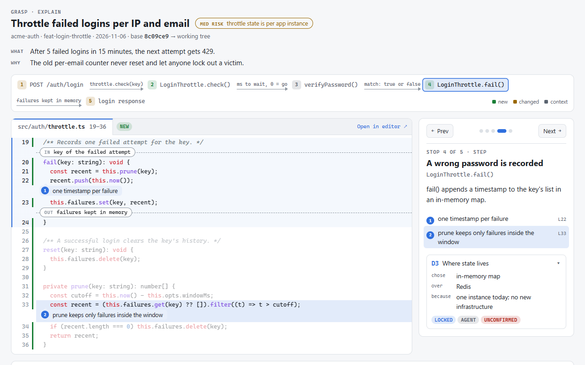

# grasp

> [!NOTE]
> grasp is being tested, and I'll likely tweak things as I use it at work and on personal projects.

grasp is a set of agent skills for keeping up with code that an agent writes for you. On a task, you make the design calls, write the parts that carry them, step through a walkthrough of the real code from entry point to exit point, and pass a quiz before you merge. Questions arrive as dialogs, with the recommended option first. A private journal keeps your reasons, so you can still answer "why is it built this way?" months later. When you're short on time, `auto` mode asks you every design question up front, then writes the code, the walkthrough and the journal while you do something else.

```
grill ──► build ──► explain ──► quiz ──► merge
  │         │          │          │
  │         │          │          └─ multiple choice; miss? → grasp-teach, then re-quiz
  │         │          └─ step-through walkthrough of the real code, entry point to exit point
  │         └─ you write the parts that carry the decisions (TODO(human) task cards)
  └─ dialogs: options + trade-offs + a recommendation; you make each call
```



| Skill | What it does | Time |
|---|---|---|
| `grasp` | Runs the whole loop and keeps the journal. `/grasp` alone opens a menu. Add `fast` to skip the hands-on build, or `auto` to answer every design question up front and let the agent finish on its own, with no quiz. | 45–90 min, 15–20 min fast, 10–20 min up front for auto |
| `grasp-grill` | Maps the decisions a task needs and asks them as dialogs, up to 3 per round. Each shows the options, their trade-offs, evidence from your code, and a recommendation. You make the call. | 10–20 min |
| `grasp-guide` | Writes the scaffolding, puts a `TODO(human)` task card in the code where you write, and opens it in your editor. Quick actions add a hint, pseudocode or boilerplate, and the review asks questions before any fix. | 20–60 min |
| `grasp-explain` | Builds a private walkthrough page that steps through the real code of the change, entry point to exit point. Each stop marks where data comes in and leaves, pins notes to lines, and opens in your editor. Supporting code is listed as skim-only, and the page is capped at 400 words. | 5 min to read |
| `grasp-quiz` | Asks 5 multiple-choice questions (why, predict, break), one dialog at a time, with a follow-up on a miss. `page` opens them as a clickable page that sends the score back. The pass mark is 80%, and misses become review cards. | 5–10 min |
| `grasp-teach` | Teaches one concept with examples from your codebase and a quick multiple-choice exercise. `review` runs the cards that are due (spaced repetition). | 5–10 min |
| `grasp-why` | Answers "why is this code like this?" from your journals, git history, and past sessions, and keeps what was recorded apart from what it infers. | 1 min |

## Install

Requirements: git and a shell. Node 18+ builds the walkthrough and the optional quiz page; without it, the agent fills the walkthrough in by hand.

Run the installer from this folder:

```
./install.ps1     # Windows (PowerShell)
./install.sh      # macOS and Linux
```

It copies the skills to `~/.claude/skills`, which Claude Code and OpenCode both read, and adds `/grasp` commands for OpenCode to `~/.config/opencode/commands`. Run it again to update. `./install.ps1 -Uninstall` or `./install.sh --uninstall` removes the skills and commands and leaves your journals alone.

For other agents, use the skills CLI: `npx skills add <path-to-grasp> -g -a codex` (or `-a cursor`, and so on). The skills use the [Agent Skills](https://agentskills.io) format.

To use grasp on another machine, copy this folder or clone it from your git host, then run the installer there.

## Use

| Agent | Start the loop | Run one step |
|---|---|---|
| Claude Code | `/grasp add retries to the http client` | `/grasp-grill`, `/grasp-quiz`, `/grasp-teach review`, `/grasp-why src/app.ts:42` |
| OpenCode | `/grasp add retries to the http client` | `/grasp-grill`, `/grasp-quiz`, and the other installed commands |
| Codex | `$grasp add retries to the http client` | `$grasp-quiz` and the rest |

`/grasp` alone prints this card, then offers to resume, walk through or quiz on the current change, or review due cards:

```
grasp · learn while you build
/grasp <task> [full|fast|auto]      grill → build → explain → quiz
    full   you write the key parts               45–90 min
    fast   I write the code, you decide          15–20 min
    auto   answer everything up front, no quiz   10–20 min
/grasp-grill [task]                 design questions only
/grasp-guide                        write the key parts of an agreed plan
/grasp-explain [base]               step through the current change
/grasp-quiz [page] [last commit | <sha> | plan]   check yourself, 80% passes
/grasp-teach <concept> | review     learn a concept · review due cards
/grasp-why <file:line | question>   why is this code like this?
```

End the task with a mode word (`full`, `fast` or `auto`), as in `/grasp fix the flaky date parser fast`. Without one, grasp asks which mode you want.

| Mode | What you do | Your time |
|---|---|---|
| `full` | Make every design call, write the key parts, step through the walkthrough, pass the quiz | 45–90 min |
| `fast` | Make the hard-to-reverse design calls, step through the walkthrough, pass the quiz | 15–20 min |
| `auto` | Make every design call up front, then leave the rest to the agent | 10–20 min, all at the start |

In auto mode, once you confirm the plan, the agent writes all the code and opens the walkthrough when it's done, without stopping to ask anything else. Run `grasp-quiz` on the branch when you have 5 minutes.

## How grasp asks

Every question comes through your agent's question dialog, with the recommended option first: pick with the arrow keys and Enter. Choose Other to type your own answer or ask a question. 🔒 decisions, the hard-to-reverse ones, get one more question on why your choice wins. Where an agent has no dialog, or blocks it in the current mode, grasp posts a numbered list and you reply with a number.

## Where your data lives

| File | Path under `~/.grasp/` |
|---|---|
| Journal | `<repo>/<branch>/journal.md` |
| Walkthrough | `<repo>/<branch>/tour.json`, `explain.html` |
| Quiz page | `<repo>/<branch>/quiz.json`, `quiz.html`, `quiz-result.json` |
| Review deck | `deck.md` |
| Settings | `settings.json`, such as the editor grasp opens files in |

Set `GRASP_HOME` to keep them somewhere else.

grasp writes nothing to your repo, commit messages, PR text, or code comments. The one exception is the `TODO(human)` task cards during the build step, and those are gone before the walkthrough is built. It never commits or pushes unless you ask, so your team's commit format stays as it is.

The journal records each decision, the options you rejected, and your reasons in your own words. When you take the recommended option without giving a reason, it records the agent's reason and labels it as the agent's. `grasp-why` reads the journal when someone asks why the code looks the way it does, and says whose reason it's quoting.

## Works well with Claude Code

- `/output-style learning` gives you the same `TODO(human)` style of practice for everyday work outside grasp.
- `"cleanupPeriodDays": 3650` in `~/.claude/settings.json` keeps session transcripts for ten years instead of the default 30 days. With that set, the `session:` line in a journal can reopen the original conversation with `claude --resume <id>`.

## Why this design

- In Shen and Tamkin's 2026 trial at Anthropic, developers who asked "why" follow-up questions after generating code scored 86% on a later quiz, and those who only delegated scored 39%. The groups behind those two numbers were small.
- In Sankaranarayanan's 2026 study, having to explain code back before merging cut failures on a later maintenance task, done without AI, from 77% to 39%.
- Producing an answer builds memory better than rereading one (Bjork and Bjork's work on desirable difficulties), so grasp has you decide, write, and answer questions about the change. The dialogs are multiple choice to keep it quick, which is easier than recalling from scratch. Choose Other to answer in your own words.

## Credits

- The grill rounds adapt Matt Pocock's [`grilling`](https://github.com/mattpocock/skills) skill (MIT), which walks a design as a tree of decisions.
- The quiz's one-question-at-a-time follow-ups adapt rodbv's [`quiz-me`](https://github.com/rodbv/socratic-skills) (MIT).
- The guided build is modeled on Claude Code's Learning output style, with its `TODO(human)` contributions and `★ Insight` notes.
- The walkthrough draws on Geoffrey Litt's explain-diff and nicobailon's [visual-explainer](https://github.com/nicobailon/visual-explainer).

## Status

Version 0.2.0. On Windows with Claude Code, the walkthrough builder and its page, and the quiz page with its result hand-off, have been tested on a demo repo. The dialog-driven grill, guide and quiz flows are new and have not been run end to end yet. OpenCode reads the same `~/.claude/skills` folder. Codex does not, so it needs the skills CLI step under *Install*. omp can load them from Claude Code's folder, though that may need switching on in its settings. None of the three has been tried.

## License

MIT
