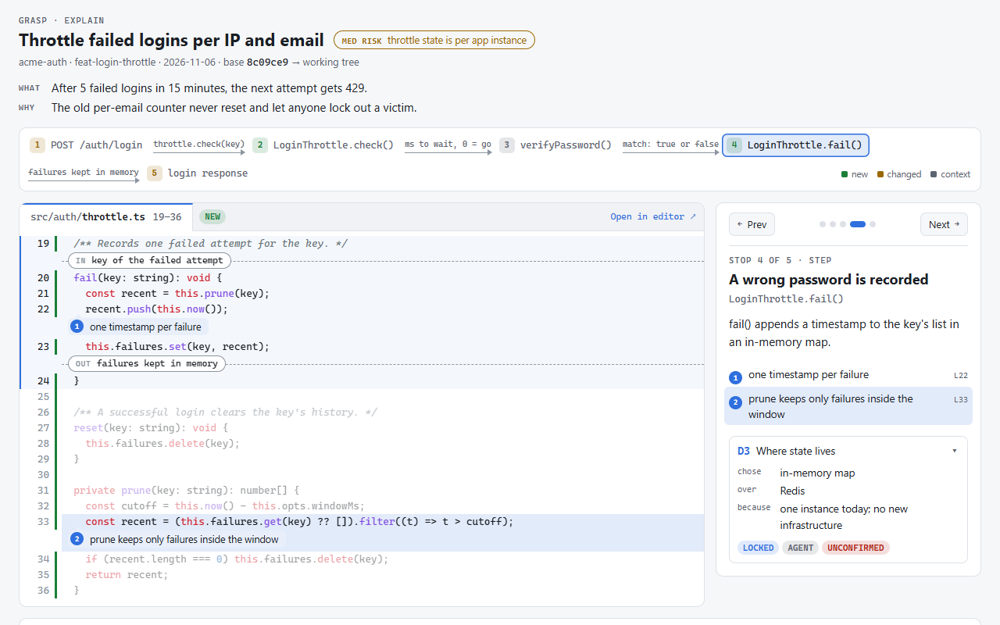

# grasp

> [!NOTE]
> grasp is being tested, and I'll likely tweak things as I use it at work and on personal projects.

grasp is a set of agent skills for keeping up with code that an agent writes for you. On a task, you make the design calls, write the parts that carry them, listen to a narrated walkthrough that steps through the real code from entry point to exit point, and pass a quiz before you merge. Questions arrive as dialogs, with the recommended option first. A private journal keeps your reasons, so you can still answer "why is it built this way?" months later. When you're short on time, `auto` mode asks you every design question up front, then writes the code, the walkthrough and the journal while you do something else. For a task too big for one agent, `pm` mode has sub-agents build it in parallel, then brings every choice they made back to you.

```
grill ──► build ──► explain ──► quiz ──► merge
  │         │          │          │
  │         │          │          └─ multiple choice; miss? → grasp-teach, then re-quiz
  │         │          └─ narrated walkthrough: a voice talks you through the real code, entry to exit
  │         └─ you write the parts that carry the decisions (TODO(human) task cards)
  └─ dialogs: options + trade-offs + a recommendation; you make each call
```



| Skill | What it does | Time |
|---|---|---|
| `grasp` | Runs the whole loop and keeps the journal. `/grasp` alone opens a menu. Add `fast` to skip the hands-on build, `auto` to answer every design question up front and let the agent finish on its own with no quiz, or `pm` to have sub-agents build a big task. | 55–105 min, 25–35 min fast, 10–20 min up front for auto, 35–50 min plus the build for pm |
| `grasp-grill` | Maps the decisions a task needs and asks them as dialogs, up to 3 per round. Each shows the options, their trade-offs, evidence from your code, and a recommendation. You make the call. | 10–20 min |
| `grasp-guide` | Writes the scaffolding, puts a `TODO(human)` task card in the code where you write, and opens it in your editor. Quick actions add a hint, pseudocode or boilerplate, and the review asks questions before any fix. | 20–60 min |
| `grasp-pm` | Builds a big task with sub-agents, with the agent as project manager. You confirm the split first: the parts, the model that builds each, and the contracts between them. A board in your journal shows who is building what, and every choice a sub-agent made on its own comes back to you as a dialog. | 25–40 min, plus the build |
| `grasp-explain` | Builds a private, narrated walkthrough of the change. Press Play and a natural voice follows one real input from entry point to exit point. It steps into each method the path calls, explains the code line by line while highlighting it, defines each term as it comes up, and moves on by itself. Each stop marks where data comes in and leaves, shows what the new code replaced, and opens in your editor. | 8–20 min to listen, 5 to skim |
| `grasp-quiz` | Asks 5 multiple-choice questions (why, predict, break), one dialog at a time, with a follow-up on a miss. `page` opens them as a clickable page that sends the score back. The pass mark is 80%, and misses become review cards. | 5–10 min |
| `grasp-teach` | Teaches one concept with examples from your codebase and a quick multiple-choice exercise. `review` runs the cards that are due (spaced repetition). | 5–10 min |
| `grasp-why` | Answers "why is this code like this?" from your journals, git history, and past sessions, and keeps what was recorded apart from what it infers. | 1 min |

## Install

Requirements: git and a shell. Node 18+ builds the walkthrough, its voice and the optional quiz page; without Node, the agent fills the walkthrough in by hand and it speaks with the browser's voice. `pm` mode needs an agent that can start sub-agents; without one, the agent builds the task itself.

Run the installer from this folder:

```
./install.ps1     # Windows (PowerShell)
./install.sh      # macOS and Linux
```

The installer also sets up the walkthrough voice: [Kokoro](https://huggingface.co/hexgrad/Kokoro-82M) (Apache-2.0), a small text-to-speech model that runs on your machine, so nothing you build is sent anywhere. It goes in `~/.grasp/_voice` and takes about 750 MB, downloaded once, with exact package versions from a lockfile. `./install.ps1 -NoVoice` or `./install.sh --no-voice` skips it; the walkthrough then speaks with your browser's voice, which sounds best in Edge. To add the voice later, run `node ~/.claude/skills/grasp-explain/voice.mjs install`.

It copies the skills to `~/.claude/skills`, which Claude Code and OpenCode both read, and adds `/grasp` commands for OpenCode to `~/.config/opencode/commands`. Run it again to update. `./install.ps1 -Uninstall` or `./install.sh --uninstall` removes the skills and commands and leaves your journals alone.

For other agents, use the skills CLI: `npx skills add <path-to-grasp> -g -a codex` (or `-a cursor`, and so on). The skills use the [Agent Skills](https://agentskills.io) format.

To use grasp on another machine, copy this folder or clone it from your git host, then run the installer there.

## Use

| Agent | Start the loop | Run one step |
|---|---|---|
| Claude Code | `/grasp add retries to the http client` | `/grasp-grill`, `/grasp-quiz`, `/grasp-teach review`, `/grasp-why src/app.ts:42` |
| OpenCode | `/grasp add retries to the http client` | `/grasp-grill`, `/grasp-quiz`, and the other installed commands |
| Codex | `$grasp add retries to the http client` | `$grasp-quiz` and the rest |

`/grasp` alone prints this card, then offers to resume, walk through or quiz on the current change, or review due cards:

```
grasp · learn while you build
/grasp <task> [full|fast|auto|pm]   grill → build → explain → quiz
    full   you write the key parts               55–105 min
    fast   I write the code, you decide          25–35 min
    auto   answer everything up front, no quiz   10–20 min
    pm     big task, built by sub-agents         35–50 min
/grasp-grill [task]                 design questions only
/grasp-guide                        write the key parts of an agreed plan
/grasp-pm [task | review]           build with sub-agents · review their choices
/grasp-explain [base]               a narrated walkthrough of the current change
/grasp-quiz [page] [last commit | <sha> | plan]   check yourself, 80% passes
/grasp-teach <concept> | review     learn a concept · review due cards
/grasp-why <file:line | question>   why is this code like this?
```

End the task with a mode word (`full`, `fast`, `auto` or `pm`), as in `/grasp fix the flaky date parser fast`. Without one, grasp asks which mode you want.

| Mode | What you do | Your time |
|---|---|---|
| `full` | Make every design call, write the key parts, listen to the walkthrough, pass the quiz | 55–105 min |
| `fast` | Make the hard-to-reverse design calls, listen to the walkthrough, pass the quiz | 25–35 min |
| `auto` | Make every design call up front, then leave the rest to the agent | 10–20 min, all at the start |
| `pm` | Make the hard-to-reverse design calls, confirm how the work is split, review the choices the sub-agents made, listen to the walkthrough, pass the quiz | 35–50 min, plus the build |

In auto mode, once you confirm the plan, the agent writes all the code and opens the walkthrough when it's done, without stopping to ask anything else. Play it, and run `grasp-quiz` on the branch, whenever you have the time.

In pm mode, the agent is the project manager and sub-agents write the code. You stay in the loop at three points:

1. **Before the build**, you confirm the split: the parts, the model that builds each, and the contracts between them.
2. **During it**, a board in your journal shows who is building what, and each part that lands gets one line in chat. grasp asks you nothing unless every remaining part is blocked, so you can walk away.
3. **After it**, every choice a sub-agent made that the plan didn't cover comes back as a dialog. You keep it, change it, or look at the code first.

The walkthrough then follows the path across the parts, and the quiz adds a question on one of the contracts and one on a sub-agent's choice. Pick `Go, hands-off` at the split to skip the review and the quiz; `/grasp-pm review` goes through the sub-agents' choices whenever you're ready.

## The narrated walkthrough

Open the page, press **Play** (or Space), and it talks you through the change like a senior engineer pairing with you:

- **Overview.** What changed and why, the few words the change rests on, and a map of the path. Each stop lights up as it's named.
- **Each stop.** The voice follows one real input, with real values, through the code. It walks the lines top to bottom, and while it talks the lines it's discussing light up, the rest fade, and the names it says are boxed in the code. Removed code unfolds when the voice explains what it replaced. When the path calls into another method, the walkthrough steps into it: the call stack at the top shows where you are, the way a debugger does, and steps back out when the method returns.
- **Words to know.** The first time the voice says a term, it defines it in that sentence, and a definition card pops up. All the terms are listed at the bottom.
- **Recap.** The path in one breath, the decisions behind it, the risks, and one question to check yourself.

Subtitles under the code mark each word as it's spoken. The side panel holds the full transcript; click any line to jump there. It moves to the next stop by itself, or untick *Auto-advance* to pause after each one.

| Key | Does |
|---|---|
| Space or K | play, pause |
| ← → | previous or next stop |
| [ ] | previous or next sentence |

Speed goes from 0.85× to 1.75×. *Voice* switches between the natural voice, your browser's voice, and captions only, which plays silently at reading pace.

## How grasp asks

Every question comes through your agent's question dialog, with the recommended option first: pick with the arrow keys and Enter. Choose Other to type your own answer or ask a question. 🔒 decisions, the hard-to-reverse ones, get one more question on why your choice wins. Where an agent has no dialog, or blocks it in the current mode, grasp posts a numbered list and you reply with a number.

## Where your data lives

| File | Path under `~/.grasp/` |
|---|---|
| Journal | `<repo>/<branch>/journal.md`, which also holds the board in pm mode |
| Walkthrough | `<repo>/<branch>/tour.json`, `explain.html`, and its voice clips in `audio/` (about 3 MB a minute) |
| Quiz page | `<repo>/<branch>/quiz.json`, `quiz.html`, `quiz-result.json` |
| Review deck | `deck.md` |
| Voice engine | `_voice/`: the Kokoro model and its runtime, shared by every walkthrough |
| Settings | `settings.json`, such as the editor grasp opens files in (`"editor": "vscode"`) and the walkthrough voice (`"voice": "am_michael"`, or `"browser"`; `node ~/.claude/skills/grasp-explain/voice.mjs voices` lists them) |

Set `GRASP_HOME` to keep them somewhere else.

grasp writes nothing to your repo, commit messages, PR text, or code comments. The one exception is the `TODO(human)` task cards during the build step, and those are gone before the walkthrough is built. It never commits or pushes unless you ask, so your team's commit format stays as it is.

The journal records each decision, the options you rejected, and your reasons in your own words. When you take the recommended option without giving a reason, it records the agent's reason and labels it as the agent's. In pm mode it also records each choice a sub-agent made and which part made it, labelled as the agent's until you approve or change it. `grasp-why` reads the journal when someone asks why the code looks the way it does, and says whose reason it's quoting.

## Works well with Claude Code

- `/output-style learning` gives you the same `TODO(human)` style of practice for everyday work outside grasp.
- `"cleanupPeriodDays": 3650` in `~/.claude/settings.json` keeps session transcripts for ten years instead of the default 30 days. With that set, the `session:` line in a journal can reopen the original conversation with `claude --resume <id>`.

## Why this design

- In Shen and Tamkin's 2026 trial at Anthropic, developers who asked "why" follow-up questions after generating code scored 86% on a later quiz, and those who only delegated scored 39%. The groups behind those two numbers were small.
- In Sankaranarayanan's 2026 study, having to explain code back before merging cut failures on a later maintenance task, done without AI, from 77% to 39%.
- Producing an answer builds memory better than rereading one (Bjork and Bjork's work on desirable difficulties), so grasp has you decide, write, and answer questions about the change. The dialogs are multiple choice to keep it quick, which is easier than recalling from scratch. Choose Other to answer in your own words.

## Credits

- The grill rounds adapt Matt Pocock's [`grilling`](https://github.com/mattpocock/skills) skill (MIT), which walks a design as a tree of decisions.
- The quiz's one-question-at-a-time follow-ups adapt rodbv's [`quiz-me`](https://github.com/rodbv/socratic-skills) (MIT).
- The guided build is modeled on Claude Code's Learning output style, with its `TODO(human)` contributions and `★ Insight` notes.
- The walkthrough draws on Geoffrey Litt's explain-diff and nicobailon's [visual-explainer](https://github.com/nicobailon/visual-explainer).
- The walkthrough's voice is hexgrad's [Kokoro-82M](https://huggingface.co/hexgrad/Kokoro-82M) (Apache-2.0), run through [kokoro-js](https://www.npmjs.com/package/kokoro-js) (Apache-2.0).
- The brief that pm mode gives each sub-agent carries a short form of forrestchang's [karpathy-guidelines](https://github.com/forrestchang/andrej-karpathy-skills) (MIT): the least code that meets the goal, in the style of the code around it.

## Status

Version 0.4.0. On Windows with Claude Code, the walkthrough builder and its page, and the quiz page with its result hand-off, have been tested on a demo repo. The narrated walkthrough was tested in headless Chrome on the same demo: the natural voice, captions-only mode, stepping into and out of methods, auto-advance, seeking, light and dark themes, and phone width. The browser-voice fallback hasn't been tested in a real browser yet. The dialog-driven grill, guide and quiz flows are new and have not been run end to end yet. Neither has pm mode (`grasp-pm`), which is written for Claude Code's sub-agents. OpenCode reads the same `~/.claude/skills` folder. Codex does not, so it needs the skills CLI step under *Install*. omp can load them from Claude Code's folder, though that may need switching on in its settings. None of the three has been tried.

## License

MIT
